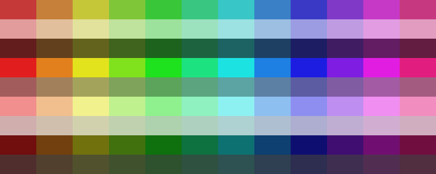

`codeviz` includes several colour palettes for visualising metrics.
Each palette is applied by appending it to a colour metric, as in `--fill file-type,categorization` or `--border file-lines,foliage`.

Ordered palettes map low-to-high metric values across a colour gradient.
The categorization palette assigns visually distinct colours to discrete categories.

## Categorization

**Name:** `categorization` · **Steps:** 108 · **Ordered:** No

The palette generates 108 colours from 12 hues, spaced 30° apart around the
colour wheel, and 9 lightness and saturation variants. Hue varies fastest:
category index modulo 12 selects a hue, while integer division by 12 selects
its variant. The mapper warns and reuses colours if there are more than 108
distinct categories.

The base colours use HSL saturation 55% and lightness 50%. Each brightness
change moves lightness 50% toward white or black; each vibrance change moves
saturation 50% toward full or zero saturation.

| Variant | Hue-wheel colours (0° through 330°, in 30° steps) |
|---------|---------------------------------------------------|
| Base | `#C63939`, `#C68039`, `#C6C639`, `#80C639`, `#39C639`, `#39C680`, `#39C6C6`, `#3980C6`, `#3939C6`, `#8039C6`, `#C639C6`, `#C63980` |
| Brighter | `#E29C9C`, `#E2BF9C`, `#E2E29C`, `#BFE29C`, `#9CE29C`, `#9CE2BF`, `#9CE2E2`, `#9CBFE2`, `#9C9CE2`, `#BF9CE2`, `#E29CE2`, `#E29CBF` |
| Darker | `#631D1D`, `#63401D`, `#63631D`, `#40631D`, `#1D631D`, `#1D6340`, `#1D6363`, `#1D4063`, `#1D1D63`, `#401D63`, `#631D63`, `#631D40` |
| More vibrant | `#E21D1D`, `#E2801D`, `#E2E21D`, `#80E21D`, `#1DE21D`, `#1DE280`, `#1DE2E2`, `#1D80E2`, `#1D1DE2`, `#801DE2`, `#E21DE2`, `#E21D80` |
| Less vibrant | `#A35C5C`, `#A3805C`, `#A3A35C`, `#80A35C`, `#5CA35C`, `#5CA380`, `#5CA3A3`, `#5C80A3`, `#5C5CA3`, `#805CA3`, `#A35CA3`, `#A35C80` |
| Brighter + more vibrant | `#F18E8E`, `#F1BF8E`, `#F1F18E`, `#BFF18E`, `#8EF18E`, `#8EF1BF`, `#8EF1F1`, `#8EBFF1`, `#8E8EF1`, `#BF8EF1`, `#F18EF1`, `#F18EBF` |
| Brighter + less vibrant | `#D1AEAE`, `#D1BFAE`, `#D1D1AE`, `#BFD1AE`, `#AED1AE`, `#AED1BF`, `#AED1D1`, `#AEBFD1`, `#AEAED1`, `#BFAED1`, `#D1AED1`, `#D1AEBF` |
| Darker + more vibrant | `#710E0E`, `#71400E`, `#71710E`, `#40710E`, `#0E710E`, `#0E7140`, `#0E7171`, `#0E4071`, `#0E0E71`, `#400E71`, `#710E71`, `#710E40` |
| Darker + less vibrant | `#512E2E`, `#51402E`, `#51512E`, `#40512E`, `#2E512E`, `#2E5140`, `#2E5151`, `#2E4051`, `#2E2E51`, `#402E51`, `#512E51`, `#512E40` |

## Temperature

**Name:** `temperature` · **Steps:** 11 · **Ordered:** Yes

A diverging palette from dark blue through white to bright red,
based on the ColorBrewer *RdBu* scheme.
Suitable for metrics where a neutral midpoint is meaningful.

| Step | Hex | RGB |
|------|-----|-----|
| 1 | `#053061` | 5, 48, 97 |
| 2 | `#2166AC` | 33, 102, 172 |
| 3 | `#4393C3` | 67, 147, 195 |
| 4 | `#92C5DE` | 146, 197, 222 |
| 5 | `#D1E5F0` | 209, 229, 240 |
| 6 | `#F7F7F7` | 247, 247, 247 |
| 7 | `#FDDBC7` | 253, 219, 199 |
| 8 | `#F4A582` | 244, 165, 130 |
| 9 | `#D6604D` | 214, 96, 77 |
| 10 | `#B2182B` | 178, 24, 43 |
| 11 | `#67001F` | 103, 0, 31 |

## Good/Bad

**Name:** `good-bad` · **Steps:** 13 · **Ordered:** Yes

A diverging palette from red through yellow to green,
based on the ColorBrewer *RdYlGn* scheme.
Use when low values are undesirable and high values are desirable (or vice versa).

| Step | Hex | RGB |
|------|-----|-----|
| 1 | `#A50026` | 165, 0, 38 |
| 2 | `#D73027` | 215, 48, 39 |
| 3 | `#F46D43` | 244, 109, 67 |
| 4 | `#FDAE61` | 253, 174, 97 |
| 5 | `#FEE08B` | 254, 224, 139 |
| 6 | `#FFFFBF` | 255, 255, 191 |
| 7 | `#FFFFFF` | 255, 255, 255 |
| 8 | `#D9EF8B` | 217, 239, 139 |
| 9 | `#A6D96A` | 166, 217, 106 |
| 10 | `#66BD63` | 102, 189, 99 |
| 11 | `#1A9850` | 26, 152, 80 |
| 12 | `#006837` | 0, 104, 55 |
| 13 | `#00441B` | 0, 68, 27 |

## Neutral

**Name:** `neutral` · **Steps:** 9 · **Ordered:** Yes

A monochromatic palette from black to white.
Useful when you want to show magnitude without implying value judgements.

| Step | Hex | RGB |
|------|-----|-----|
| 1 | `#000000` | 0, 0, 0 |
| 2 | `#202020` | 32, 32, 32 |
| 3 | `#404040` | 64, 64, 64 |
| 4 | `#606060` | 96, 96, 96 |
| 5 | `#808080` | 128, 128, 128 |
| 6 | `#A0A0A0` | 160, 160, 160 |
| 7 | `#C0C0C0` | 192, 192, 192 |
| 8 | `#E0E0E0` | 224, 224, 224 |
| 9 | `#FFFFFF` | 255, 255, 255 |

## Foliage

**Name:** `foliage` · **Steps:** 11 · **Ordered:** Yes

A plant-health palette from black (dead) through brown and orange to intense green (healthy).
Use for metrics where higher values represent vitality or activity.

| Step | Hex | RGB | Description |
|------|-----|-----|-------------|
| 1 | `#0F0A05` | 15, 10, 5 | Near black (dead) |
| 2 | `#2D190A` | 45, 25, 10 | Very dark brown |
| 3 | `#552D0F` | 85, 45, 15 | Dark brown |
| 4 | `#824614` | 130, 70, 20 | Brown |
| 5 | `#AF5F19` | 175, 95, 25 | Dark orange |
| 6 | `#D2821E` | 210, 130, 30 | Orange |
| 7 | `#E6AF28` | 230, 175, 40 | Yellow-orange |
| 8 | `#F0D732` | 240, 215, 50 | Yellow |
| 9 | `#A5C832` | 165, 200, 50 | Yellow-green |
| 10 | `#50A528` | 80, 165, 40 | Medium green |
| 11 | `#197814` | 25, 120, 20 | Intense green |

## Terrain

**Name:** `terrain` · **Steps:** 8 · **Ordered:** Yes

A geographic terrain progression from deep water through surf, sand, grass, and agricultural land to forest, rocks, and finally snow.
Evokes elevation or layered depth. Ideal for visualizing spatial or hierarchical data with natural visual associations.

| Step | Hex | RGB | Description |
|------|-----|-----|-------------|
| 1 | `#1A5276` | 26, 82, 118 | Sea |
| 2 | `#5DADE2` | 93, 173, 226 | Surf |
| 3 | `#F4D03F` | 244, 208, 63 | Sand |
| 4 | `#82E0AA` | 130, 224, 170 | Grass |
| 5 | `#52BE80` | 82, 190, 128 | Farm |
| 6 | `#1E8449` | 30, 132, 73 | Forest |
| 7 | `#6E2C00` | 110, 44, 0 | Rocks |
| 8 | `#F0F3F4` | 240, 243, 244 | Snow |

## Flame

**Name:** `flame` · **Steps:** 7 · **Ordered:** Yes

A sequential palette from dark red through orange to pale yellow.
Useful for visualising heat, intensity, or activity.

| Step | Hex | RGB |
|------|-----|-----|
| 1 | `#B10026` | 177, 0, 38 |
| 2 | `#E31A1C` | 227, 26, 28 |
| 3 | `#FC4E2A` | 252, 78, 42 |
| 4 | `#FD8D3C` | 253, 141, 60 |
| 5 | `#FEB24C` | 254, 178, 76 |
| 6 | `#FED976` | 254, 217, 118 |
| 7 | `#FFFFB2` | 255, 255, 178 |

## Ocean

**Name:** `ocean` · **Steps:** 7 · **Ordered:** Yes

A sequential palette from navy blue through mid blue to cyan.
Useful for visualising depth, flow, or volume.

| Step | Hex | RGB |
|------|-----|-----|
| 1 | `#081D58` | 8, 29, 88 |
| 2 | `#123478` | 18, 52, 120 |
| 3 | `#1955A0` | 25, 85, 160 |
| 4 | `#1D91C0` | 29, 145, 192 |
| 5 | `#22B4D2` | 34, 180, 210 |
| 6 | `#34D3E1` | 52, 211, 225 |
| 7 | `#67E8F9` | 103, 232, 249 |

## Leaf

**Name:** `leaf` · **Steps:** 7 · **Ordered:** Yes

A sequential palette from dark green through green to pale green.
Useful for visualising growth, freshness, or natural abundance.

| Step | Hex | RGB |
|------|-----|-----|
| 1 | `#005A32` | 0, 90, 50 |
| 2 | `#238B45` | 35, 139, 69 |
| 3 | `#41AB5D` | 65, 171, 93 |
| 4 | `#74C476` | 116, 196, 118 |
| 5 | `#A1D99B` | 161, 217, 155 |
| 6 | `#C7E9C0` | 199, 233, 192 |
| 7 | `#EDF8E9` | 237, 248, 233 |
